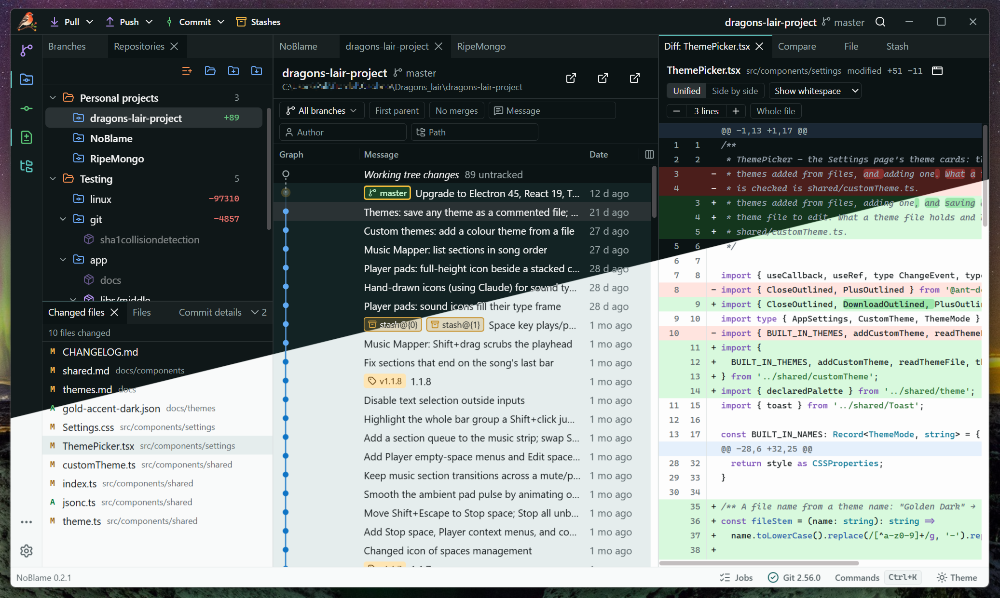

# NoBlame


A fast Git client for Windows, Linux and macOS that stays quick on giant repositories, built
with Tauri 2, Rust and React.



> **Status: version 0.3, before the first release.** There are no installers yet; build it
> from source (below). Phase 1, the full Git client, is done ([roadmap](docs/roadmap.md)).

## What it does

- **A commit graph that keeps up**: the Linux kernel's 1.5 million commits show in about half
  a second; filter by branch, author, message or path, find and jump to any commit.
- **See what changed**: diffs unified or side by side with word diff and syntax colours, file
  history that follows renames, blame, and any two revisions compared.
- **Commit with care**: stage files, hunks or single lines; amend, sign off, reuse recent
  messages; stash and get stashes back, whole or file by file.
- **Branches and remotes**: fetch, pull and push run in the background with progress and can
  be cancelled; passwords and SSH passphrases are asked in the app; one editor holds every
  setting of a remote, from its URLs to its proxy, credentials and SSH key.
- **Rewrite history safely**: merge, rebase (also interactively), cherry-pick, revert and reset,
  conflicts solved in a built-in three-way merge view, and the reflog to get lost work back.
  Anything that loses work asks first and says exactly what will go.
- **And the rest**: submodules, worktrees, Git LFS, bisect, patches and archives, your own
  scripts, a command palette and keyboard shortcuts you can change.
- **Task windows from the command line**: `noblame commit <path>`, `noblame log <path>`,
  `noblame blame <file>` and more open a window made for that one task
  ([command line](docs/user-guide/command-line.md)).

NoBlame runs the git you already have (2.39 or newer), so hooks, credential helpers, signing and
LFS behave exactly as in your terminal. It reads history with [gitoxide](https://github.com/GitoxideLabs/gitoxide)
for speed and never changes your global git settings.

Next: Phase 2, entries in the context menus of Explorer, Finder and Linux file managers that open
these task windows.

## Building from source

Needs Rust, Node.js 22.12+, pnpm and git; per-system details are in
[getting started](docs/getting-started.md).

```sh
pnpm install
pnpm app:dev      # run it
pnpm app:build    # build the installers for this system
```

## Documentation

- [User guide](docs/user-guide/README.md): how to use NoBlame, in plain language
- [Documentation index](docs/README.md): architecture, decisions (ADRs), development
- [CLAUDE.md](CLAUDE.md): a map of the code for contributors

## Licence

NoBlame is free software: you can redistribute it and/or modify it under the terms of the
[GNU General Public License](LICENSE), version 3 or (at your option) any later version. It is
distributed without any warranty. The open-source components it includes keep their own
licences (About → Third-party licences).

NoBlame is a Git client; it is not affiliated with or endorsed by the Git project.
